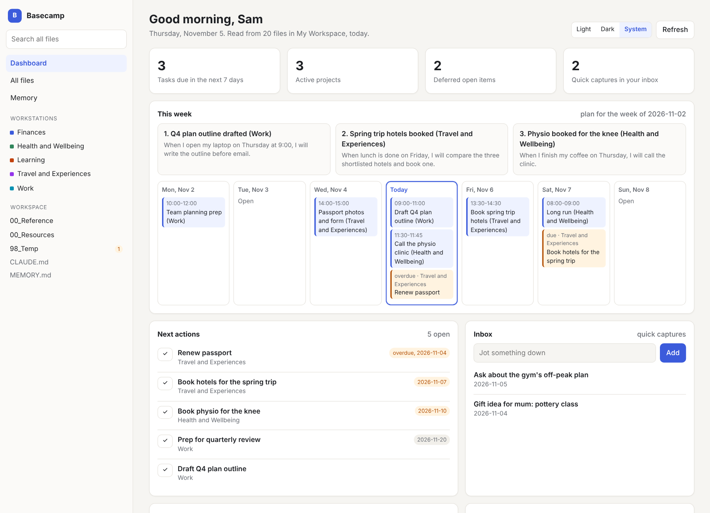
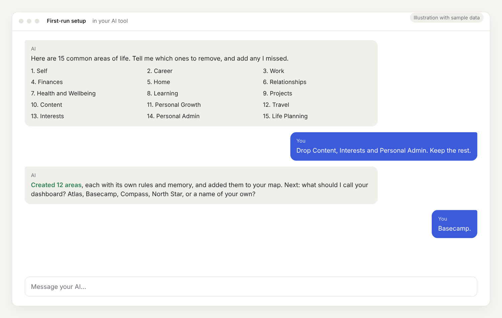
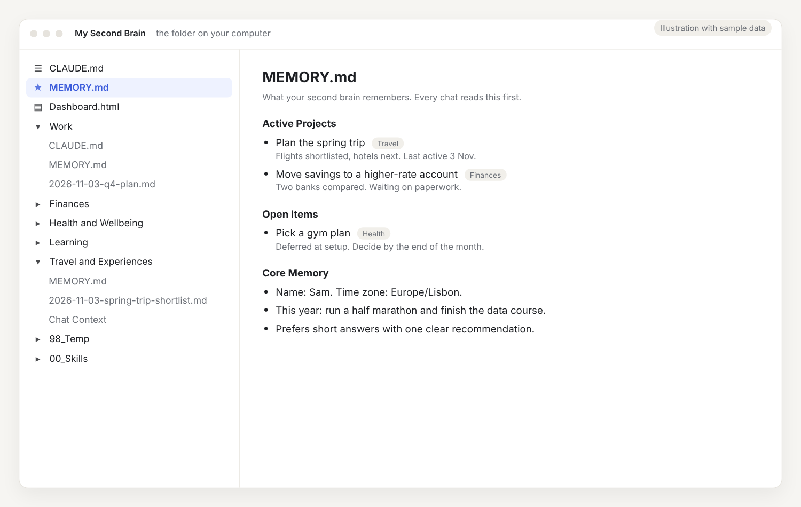
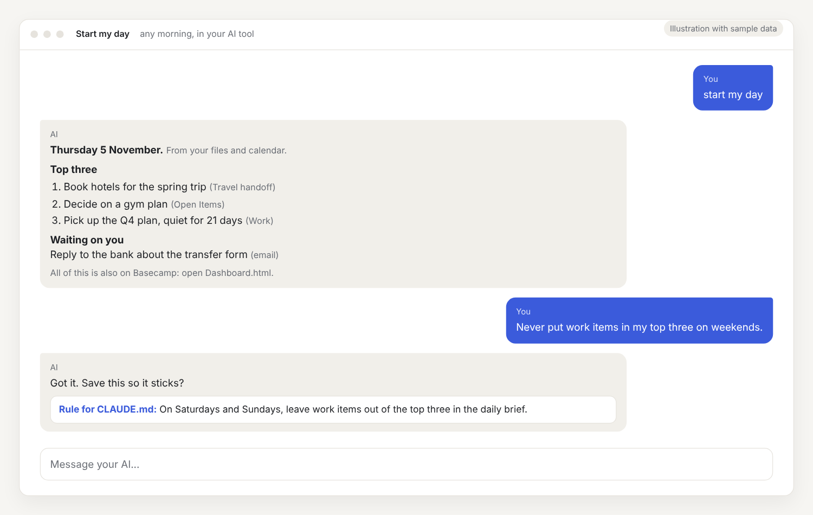

# CoworkOS

**Your AI second brain.** A folder of plain files that remembers your life and work, organised by area, so every AI chat starts already knowing you. You own the files, and any AI tool that can read a folder can use them.

<picture>
  <source media="(prefers-color-scheme: dark)" srcset=".github/assets/dashboard-dark.png">
  
</picture>

<sub>The dashboard that ships with CoworkOS, shown with sample data. It reads your files in your browser and nothing leaves your computer.</sub>

**[Quick start](#quick-start)** · **[See it in action](#see-it-in-action)** · **[What you get](#what-you-get)** · **[How it works](#how-it-works)** · **[Your dashboard](#your-dashboard)** · **[Skills](#skills-that-come-with-it)**

## Why a second brain

Every AI chat starts from zero. You explain your job, your goals and your preferences again, and the corrections you made last week are gone. One giant instruction prompt helps for a while, then it gets too long to manage and the AI starts mixing up which rules apply where.

CoworkOS fixes that with a simple structure. Each area of your life gets its own folder, such as Work, Finances, Health or Travel, with its own rules and its own memory. Your AI reads the right folder for each task, remembers what you decided, and asks before it saves anything new. Over weeks it becomes a second brain that knows you, and it is all plain text you can read, edit, move or delete at any time.

## Quick start

Copy this into the AI tool you use (Claude Cowork, or another tool that can work with files on your computer) and it does the rest:

```
I want to set up CoworkOS, my AI second brain. Please get the files
from this repository: https://github.com/theAnirudhKumar/CoworkOS

Download the files rather than keeping a git clone, so my second
brain does not carry this repository's history or point back at it.

Before saving anything, ask me exactly where I want it saved, and
confirm the full path back to me, so I have a real place to find it
later rather than a temporary folder. Save the files there.

Then read CLAUDE.md at the root of that folder and follow it,
including the first-run setup in SETUP.md. Ask me which areas of my
life or work I want to track before creating anything, and do not
create anything I did not ask for.
```

You can pause setup at any point and pick it up later. Your AI asks a few questions about you, offers a starter menu of 15 life areas to keep or remove, sets up the skills, helps you name your dashboard, and then removes the template's own files, so what is left is yours alone.

Not sure your AI tool can work with a folder on your computer? See [Using CoworkOS with Other AI Tools](00_Resources/Using%20CoworkOS%20with%20Other%20AI%20Tools.md).

## What you get

- **An AI that remembers you.** Your name, your goals, your decisions and your preferences live in memory files, and every session reads them first.
- **One folder per area of your life.** Work, Finances, Health, Learning, Travel and more, each with its own rules and memory, so the AI uses the right context for each task. Setup offers 15 common areas to start from.
- **Capture in one line.** Say "jot this down" and a passing thought lands in your inbox straight away. The weekly review files it later, so nothing gets lost because you did not know where it belonged.
- **Capture from your phone.** A one-tap iPhone shortcut, a notes app on any phone, or an email to yourself, and the thought is waiting in your inbox when you sit down. See the [Mobile Capture Guide](00_Resources/Mobile%20Capture%20Guide.md).
- **Tasks with real due dates.** "Get three quotes by Friday" becomes a task with a date in the right area, and shows up in your daily brief and on the dashboard until it is done.
- **Answers from what you actually wrote.** Ask "what did I decide about my running plan?" and it searches your whole second brain and tells you where the answer is, or says plainly that nothing was decided.
- **Corrections that stick.** When you fix something, the AI proposes a rule so it does not happen again. A close-out audit at the end of a session catches anything missed.
- **A daily brief.** Say "start my day" for the three things most worth doing today, what is waiting on you, and what is coming up, from your files and any calendar or email you connect.
- **A week you can actually follow.** Say "plan my week" and it proposes three focus outcomes, a when-and-where plan for each, and time blocks with room to spare, placed around your calendar. Pick a planning style that suits you, such as Big Three, time blocking, Eat the frog, 1-3-5, Eisenhower or Pomodoro, and the daily brief follows it too. Nothing lands on your calendar until you say yes.
- **A weekly check-up.** Say "weekly review" and in 20 to 30 minutes your second brain is tidied: inbox emptied, finished tasks cleared, overdue ones faced, finished projects archived, stale notes replaced.
- **A dashboard you name yourself.** Open one file in your browser to see everything at a glance, browse and search every file, and edit them.
- **Pick up where you left off.** Say "hand off this chat" and a fresh chat later can continue without you explaining everything again.
- **Keeps the point, not the pile.** Share an article to save and it keeps a short note: why you saved it, the few points that matter, and the source. Saving everything is the most common way a second brain dies.
- **Habits that become skills.** Ask for the same kind of work three times and it offers to save the method as a skill.
- **Private by default.** Plain markdown on your own computer. Nothing is uploaded unless you choose to sync to your own private GitHub repository, and an optional guard stops commits that contain something shaped like an ID or account number.

## See it in action

These are illustrations with sample data, so you can see what you are setting up before you start.

**1. It starts with a short conversation.** Your AI offers 15 common areas of life, you keep the ones that fit, and it creates a folder for each.

<picture>
  <source media="(prefers-color-scheme: dark)" srcset=".github/assets/2-setup-dark.png">
  
</picture>

**2. Your second brain is a folder of plain files.** Each area has its own rules and memory. `MEMORY.md` holds what your AI should never forget.

<picture>
  <source media="(prefers-color-scheme: dark)" srcset=".github/assets/1-folder-dark.png">
  
</picture>

**3. Every day, it already knows you.** Ask for your brief, and when you correct it, it offers to remember the correction for good.

<picture>
  <source media="(prefers-color-scheme: dark)" srcset=".github/assets/3-day-dark.png">
  
</picture>

## How it works

```
Your workspace/
  CLAUDE.md           Rules your AI follows, and the map of your areas
  MEMORY.md           What it remembers across sessions
  Dashboard.html      Your second brain in your browser
  Work/               One folder per area of your life, each with
  Finances/           its own CLAUDE.md (rules) and MEMORY.md (memory)
  Health/
  00_Skills/          The skills it uses, such as start-my-day
```

At the start of every chat, your AI reads `MEMORY.md`, finds the right area in the map in `CLAUDE.md`, and reads that area's own rules and memory. It does the work, then proposes anything worth remembering and saves it only when you say yes. Every rule lives in exactly one place, so nothing contradicts itself as your second brain grows.

You talk to it in your AI tool as usual. The files are the long-term memory behind the chat.

## Your dashboard

Double-click `Dashboard.html` in your workspace folder and choose the folder. You get this week's plan, with your focus outcomes and a seven-day strip of time blocks and due dates, then your next actions, your inbox with a box to jot something down, active projects, deferred items and the health of your second brain, plus a tree of every file, search across all of them and a reader for any file. In Chrome and Edge you can tick off tasks, capture to your inbox, edit files and mark items done, and it checks that a file has not changed elsewhere before saving. Other browsers show a read-only view.

It has light, dark and system themes, and it carries the name you gave it during setup. It runs entirely in your browser, with nothing to install and nothing uploaded. You can also open the same files in any notes app or editor that reads markdown.

## Skills that come with it

Say the phrase in your AI tool and it follows the skill. Setup installs them where your tool supports skills.

| Skill | Say | What it does |
| :--- | :--- | :--- |
| start-my-day | "start my day" | A short daily brief: top three, waiting on you, coming up |
| plan-my-week | "plan my week" | Focus outcomes and time blocks around your calendar |
| weekly-review | "weekly review" | A 20 to 30 minute tidy of your whole second brain |
| session-audit | "close out the session" | Saves the corrections and decisions from today |
| chat-context | "hand off this chat" | Lets a new chat pick up exactly where this one stopped |
| make-a-skill | "make this a skill" | Turns work you repeat into a reusable skill |
| optimize-tokens | "optimize tokens" | Gets the same result from a leaner request |
| travel-mode | "travel mode" | Works from your synced copy when your computer is closed |

## Works with your AI tool

CoworkOS was designed and tested on Claude Cowork, and it has also been tested on Codex. The files are plain markdown with no special format, so any AI tool that can read and write a folder on your computer can use them. A one-line `AGENTS.md` points tools that look for that file to `CLAUDE.md`. [Using CoworkOS with Other AI Tools](00_Resources/Using%20CoworkOS%20with%20Other%20AI%20Tools.md) has notes for specific tools and what to check first.

## Your data stays yours

Everything is plain text in a folder you choose. You can read every file, and nothing is hidden in an app or a database. Syncing is off by default. If you turn it on, your second brain goes to a private GitHub repository under your own account, which lets you reach it from your phone, and a pre-commit guard refuses any commit that contains something shaped like an ID or account number. See the [GitHub Sync Guide](00_Resources/GitHub%20Sync%20Guide.md).

<details>
<summary><strong>Set it up by hand instead</strong></summary>

1. Get the files. On this page, click the green **Code** button, choose **Download ZIP**, and unzip it somewhere you will find again.
2. Give your AI tool access to that folder. If you are not sure how, ask your AI tool directly, since each tool has its own way.
3. Look at `Example Workstation/` to see what an area of your life looks like once it is filled in.
4. Start a chat and say what you want to track. `CLAUDE.md` sends your AI tool to `SETUP.md`, which runs the same first-run setup as the quick start.

</details>

<details>
<summary><strong>What setup removes from your copy</strong></summary>

This repository holds two kinds of file: your second brain itself, and the material for maintaining the template (this README, `CHANGELOG.md`, `CONTRIBUTING.md`, `validate.py` and `.github/`). The last step of setup removes the second kind, clears the example entries, removes any link back to this repository, offers to drop this repository's git history if you cloned it, and then deletes `SETUP.md`. What is left is yours alone, apart from the `LICENSE` notice, which the license requires every copy to keep. If you set up before this step existed, [Troubleshooting](00_Resources/Troubleshooting.md) has the one-line request to give your AI tool to do the same now.

</details>

<details>
<summary><strong>Using git? Protect what goes in</strong></summary>

Your second brain will hold real personal information. If you keep it under version control, that information ends up in git history too, and git history is permanent by default. `.gitignore` keeps common personal-document filenames out, and `.githooks/pre-commit` scans every commit for the shape of a government ID, a bank identifier or an account number and refuses the commit if it finds one. It ships with example formats for India and the United States; read the comments at the top of the file and adjust them for where you live. Turn it on once, from inside the workspace:

```bash
git config core.hooksPath .githooks
chmod +x .githooks/pre-commit
```

</details>

<details>
<summary><strong>Everything in the box</strong></summary>

| Path | Purpose |
| :--- | :--- |
| `CLAUDE.md` | The rules your AI follows: memory, routing, governance, and the map of your areas |
| `SETUP.md` | First-run setup; deletes itself and the template-maintainer files below when finished |
| `MEMORY.md` | What your second brain remembers across sessions |
| `ARCHIVE.md` | The historical record: completed work, read only on demand |
| `Dashboard.html` | Your second brain as a page in your browser: dashboard, every file, search, and edits |
| `AGENTS.md` | A one-line pointer to `CLAUDE.md` for AI tools that look for that name |
| `98_Temp/`, `99_Archive/` | A holding folder for files with no clear home yet, and a folder for old files that are no longer current |
| `00_Reference/Governance Rules.md` | Section ordering, size caps, and the rules for where content goes |
| `00_Reference/File Creation Rules.md` | Naming, placement, and approval rules for new files |
| `00_Reference/Memory System.md` | Full mechanics: capture triggers, entry format, archiving |
| `00_Reference/Visual Standards.md` | Layout rules for steps, tables, diagrams and generated documents |
| `00_Reference/CLAUDE.md Change Log.md` | The record of every substantive change to root `CLAUDE.md`, and what counts as one |
| `00_Resources/Workstation Setup Guide.md` | How to create a new area, and the Starter Workstations menu |
| `00_Resources/Planning Methods.md` | Planning styles to choose from, and the rules every week plan follows |
| `00_Resources/Mobile Capture Guide.md` | Jotting things down from your phone: a synced folder, email to yourself, or travel mode |
| `00_Resources/Connectors Guide.md` | Which apps to connect first, what each unlocks, and the safety rules |
| `00_Resources/Starter Rules.md` | An optional menu of proven working rules, offered once during setup |
| `00_Resources/voice-principles.md` | Starter file for how written output should sound; fills in through use |
| `00_Resources/Using CoworkOS with Other AI Tools.md` | Running this on another AI tool, and what to check first |
| `00_Resources/GitHub Sync Guide.md` | Setting up the optional GitHub sync |
| `00_Resources/Troubleshooting.md` | Fixing common install and setup problems |
| `00_Skills/Skills Inventory.md` | Index of the skills and where their copies live |
| `00_Skills/Custom/session-audit/SKILL.md` | End-of-session capture and optional sync |
| `00_Skills/Custom/travel-mode/SKILL.md` | Working from the GitHub copy when your primary computer is unreachable |
| `00_Skills/Custom/chat-context/SKILL.md` | Handing a long chat off to a fresh one, and resuming from the handoff |
| `00_Skills/Custom/weekly-review/SKILL.md` | A short weekly upkeep that keeps your second brain trustworthy |
| `00_Skills/Custom/start-my-day/SKILL.md` | A daily brief built from your files, plus any connected apps, read-only |
| `00_Skills/Custom/plan-my-week/SKILL.md` | A week plan with focus outcomes and time blocks, put on your calendar only on a yes |
| `00_Skills/Custom/make-a-skill/SKILL.md` | Turning a repeated piece of work into a reusable skill |
| `00_Skills/Custom/optimize-tokens/SKILL.md` | Getting the same result from a leaner request |
| `00_Skills/Third-Party/` | Where someone else's archived skill goes |
| `Example Workstation/` | A filled-in sample area: `CLAUDE.md` and `MEMORY.md` with realistic content |
| `.gitignore`, `.githooks/pre-commit` | Optional protection if you version-control your second brain |
| `CONTRIBUTING.md` | How to propose a change to this repository (removed from your copy at the end of setup) |
| `CHANGELOG.md` | What changed in this template, release by release (removed at the end of setup) |
| `validate.py`, `.github/` | Structural checks and the README images (removed at the end of setup) |

</details>

## Credits

The workstation architecture is adapted from Jeff Su's Claude Cowork tutorials, in particular ["Claude Cowork for Beginners: Build Your Own Jarvis"](https://www.jeffsu.org/claude-cowork-build-your-own-jarvis/) and the video ["Learn 80% of Claude Cowork in Under 20 Minutes"](https://www.youtube.com/watch?v=z9rdrNrkvDY). If you are new to the pattern, start there.

## Contributing

CoworkOS is a template meant for a stranger to adapt, so changes go through an issue and a pull request, and the bar includes staying generic. See [CONTRIBUTING.md](CONTRIBUTING.md).

## License

MIT. See [LICENSE](LICENSE).
